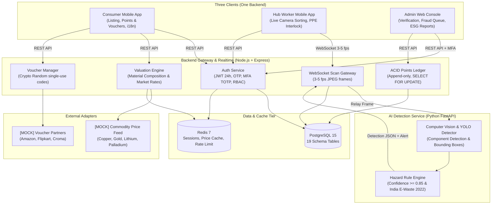

# EcoCircuit - Smart E-Waste Management & Circular Economy Platform

A production-grade monorepo powering consumer e-waste recovery, real-time AI computer vision for hub sorting & hazard mitigation, and circular economy governance.

---

## 1. System Architecture



---

## 2. Monorepo Structure

| Directory | Description | Status |
|:---|:---|:---|
| `packages/common` | Shared TypeScript types, Zod validation schemas, India E-Waste rules constants | **Phase 0 Complete** |
| `services/backend` | Node.js Express server, Postgres 15 migrations & seeds, Redis caching, Ledger | **Phase 0 Complete** |
| `services/ai-service` | Python FastAPI + OpenCV/TensorFlow service with /detect endpoint | **Phase 0 Scaffolded** |
| `apps/mobile` | React Native (Expo) consumer & hub worker mobile app with i18n (en/ta/hi) | **Scaffolded** |
| `apps/admin` | React + Vite administrative dashboard with ESG reporting and fraud queue | **Phase 0 Ready** |

---

## 3. Explicitly Labeled Mocks (as required by contract)

| Component | Status | Location | Notes |
|:---|:---|:---|:---|
| `MockCommodityPriceAdapter` | **MOCK** | `services/backend/src/adapters/commodityPriceAdapter.ts` | Simulates LME/MCX copper, gold, lithium, palladium feeds with cached fallback |
| `MockVoucherProvider` | **MOCK** | `services/backend/src/adapters/voucherProviderAdapter.ts` | Generates secure simulated Amazon/Flipkart/Croma vouchers via `crypto.randomBytes` |
| `MockDetector` | **MOCK** | `services/ai-service/app/detector.py` | Supplies reference PCB/Battery detections matching the YOLO output schema |

---

## 4. Phase 0 Deliverables Verified

1. **Docker Compose**: Multi-container setup for PostgreSQL 15, Redis 7, Backend, AI Service, and Admin web.
2. **Postgres 15 DDL Migration**: `001_initial_schema.sql` covering all 19 entities:
   `users`, `roles`, `hubs`, `hub_workers`, `gadget_listings`, `listing_photos`, `material_composition`, `valuations`, `pickups_dropoffs`, `points_ledger`, `voucher_inventory`, `redemptions`, `scan_sessions`, `scan_items`, `hazard_alerts`, `safety_guidelines`, `fraud_flags`, `audit_log`, `impact_metrics`.
3. **Statutory Seed Data**: `002_seed_data.sql` with real material compositions, hazard classifications, and PPE guidelines under India's E-Waste (Management) Rules 2022.
4. **Zod Validation Schemas**: Strict validation for all API routes in `packages/common/src/schemas`.
5. **CI Workflow**: `.github/workflows/ci.yml` checking lint, TypeScript build, and Phase 0 test verification.
6. **Architecture Decisions**: Documented in `DECISIONS.md`.

---

## 5. Quickstart & Testing

```bash
# Start all infrastructure
docker compose up -d postgres redis

# Run Phase 0 database migration & verification test
npm run test:phase0
```
